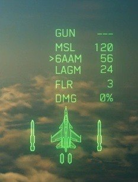

# HUD-SP-SILHOUETTE-001：特殊兵装装填剪影偶发不匹配

当前状态（2026-10-15）：用户已授权修复。候选 `1.0.2-su30sm-three-sp.2` 同步刷新原生贴图缓存与显隐重绘标志，用户随后确认武器切换和剪影均正常，见[复测证据](../../evidence/su30sm-three-sp-candidate.2-user-validation.json)。见[本次修订](three-sp-switch-hud-fix.txt)及[原生函数证据](../../evidence/three-sp-switch-hud-research.json)。以下是最初登记时的历史范围，不再作为禁止修复的依据。

2026-10-15，用户在 Su-30SM 固定挂载候选 `1.0.2-su30sm-mount.2` 中反馈：6AAM 本应显示六枚导弹的装填图标，偶尔变成两枚，并与 LAGM 剪影相同。用户明确要求本次只记录、不修复，继续其他固定挂载研究。

用户同时确认实体挂载、模型显示、武器切换及发射全部正常，符合预期。该问题独立于本次实体挂载验收，不把 HUD 剪影数量直接当作实际装填窗口、齐射数量或物理挂点数量。

截图可确认：选择箭头指向 6AAM，文字显示 6AAM 56 发、LAGM 24 发；飞机示意图左右各有一个大导弹剪影，下方另有两个小符号。截图没有展示此前切换顺序或动态装填过程，不能单凭此图确认触发条件。

用户认为该现象可能一直存在、不定期触发，可能不是固定挂载原型引入。此处保存为用户的历史印象，**发生版本、首次引入时间及根因尚未确认**。本轮不检查或修改 HUD 剪影刷新逻辑，不以旧版本问题或原型回归作定论。

后续若用户授权专项处理，再建立可重复的切换/装填操作记录，并对照当时的实际武器类、逻辑装填窗口和 HUD 内容。当前状态：已记录、暂缓调查与修复。关联[原型用户验证](../../evidence/su30sm-fixed-mount-user-validation.json)。
