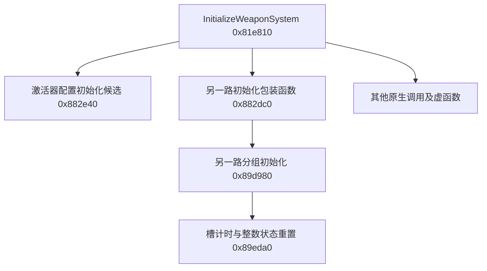
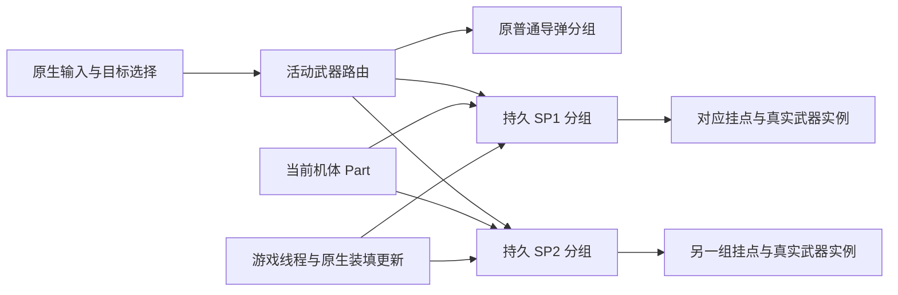

# 两套 SP 持续挂载：替代全量初始化的可行性研究

日期：2026-10-13。分支：`codex/persistent-sp-research`，起点为 `main` 的 `6381ccd`。返回[项目入口](../../AGENTS.md)；相关资料见[模型研究](weapon-models.md)、[现有核心](core-findings.md)、[本轮精简证据](../../evidence/persistent-sp-offline.json)。

## 结论与边界

长期主方向建议为：**保留一个原生武器控制器，管理两套持久 SP 分组，切换时选择对应组，不重新初始化整套武器。** 这是由现有结构支持的工程候选，尚未证明存在可直接使用的原生接口，不能写成已实现或已实机通过。

本轮没有找到已验证的“选择第二 SP 且不重建”的接口。`ToggleSpecial` 在当前项目中用于普通导弹与当前 SP 的切换，不是已确认的三武器选择器。激活器中的 `SpecialWeaponConfig1/2/3` 是三选一配置，也不是三套已创建的运行时武器组。

更小范围的初始化适合研究如何建立第二套武器，**仅换成一个更低层的初始化函数，并不能自动达到两套模型持续存在的目标**。需要同时解决独立武器实例、原生引用、装填、发射位置和生命周期。

本轮工作只包括：代码审查、重新整理历史函数体、读取自有两份 PAK 的目录及少量资源副本、检索作者资料。未启动或读取游戏进程，未改写游戏文件，未编译、编写测试模块或运行测试。

## 新取得的依据

### 1. 全量入口可以拆出下层研究目标，但下层并非已确认的 SP 专用入口

历史函数体显示以下调用关系；图中的地址均为旧构建记录的 RVA，不能据此调用新进程。



| 片段 | 本轮可确认内容 | 不能确认内容 |
|---|---|---|
| `0x81e810` | 把配置索引传入激活器下层；还调用其他初始化和机体相关函数 | 全部子调用的副作用、Part 应用顺序 |
| `0x882e40` | 有配置索引参数，读取机体相关对象，并继续访问原生配置 | 记录只覆盖函数前段；不能断言仅修改 SP 或不会销毁旧实例 |
| `0x882dc0 → 0x89d980` | 存在另一路分组初始化调用；后者写入组内字段并建立槽相关数据 | 不能把这一路仅凭布局命名为 SP2；具体通道身份还需确认 |
| `0x89eda0` | 清零一个组内整数状态，并写入各槽的装填时长及进度；槽步长为 `0x60` | 此处整数与正式 SP 缓存字段的映射尚未确认；不能用它做无损选择或证明实例持续存在 |

这些依据支持继续拆分“建立武器”和“选择武器”，但不足以直接选择一个 RVA 替换当前调用。[指令来源及摘要](../../evidence/persistent-sp-offline.json)

### 2. 控制器之外还有共享的实例与目标管理

既有反射记录中存在 `ActiveSWPMeshComponent`、`SpawnedWeapons`、`ActiveWeapons`、`HomingTargets`、`DummyPredictionWeapon`；机体还维护 `FiredExplosiveWeapons`。当前缓存没有建立两套这些对象的完整所有权关系。

当前 SP 状态在已定位的状态结构 `+0x110` 内，属于内嵌分组。**不能假设游戏已有“活动 SP 分组指针”，也不能仅切换 `SpecialWeaponClass` 来切换完整武器。** 新路线可能需要拦截取得分组的原生调用，让发射、装填、参数查询和目标管理访问一致的组。哪些调用接受分组地址、哪些固定访问内嵌地址，尚待定位。

来源：[激活器反射记录](../../evidence/native/自由飞行-PlayerWeaponActivator.txt)、[机体反射记录](../../evidence/native/自由飞行-PlayerPlane.txt)、[当前分组定位](../../src/weapon_bridge.cpp)。

### 3. Part 存在细分的武器参数类别

从自有 `PartsDataTable` 解码副本中取得以下枚举名称线索：

| 类别前缀 | 示例 |
|---|---|
| `SpMslAir` | `SpMslAirPayload`、`SpMslAirReload`、`SpMslAirPower`、`SpMslAirHomingAng` |
| `SpMslGrd` | `SpMslGrdPayload`、`SpMslGrdReload`、`SpMslGrdPower`、`SpMslGrdLockonRange` |
| `Bomb` | `BombPayload`、`BombReload`、`BombExplosionRadius` |
| `Laser` | `LaserPower`、`LaserDamageRadius`、`LaserEffectiveTime` |
| `EML` | `EMLPower`、`EMLRayCastRadius`、`EMLEffectiveTime` |
| `Msl`、`MGP`、`Rkt` | 普通导弹、机炮吊舱、火箭相关参数名称 |

因此，新架构必须保留武器类别和对应的参数应用过程，不能把所有 SP 归为同一种增益类别。上述只是枚举名称，**不证明每个字段都有可装备的部件，也不证明当前模组正确应用了它们**。本轮没有解析具体 Part 行、倍率或生效函数。

副本来自本机 `pakchunk0-WindowsNoEditor.pak` 与 `_0_P.pak`，没有调查其他模组的资源覆盖优先级，不能把它们当作运行现场的最终有效配置。摘要保留资源路径、SHA256 和名称所在文件偏移，不保留完整游戏资源。

### 4. 第二发射通道确有作者案例，但副油箱通道不等价于完整 SP2

既有机体反射记录提供 `DropTankWeaponClass`、`DropTankInputDuration`、`DropTankMeshComponent`。本轮索引也确认了原生 `plwp_droptank` 资源，其解码副本包含 `Bomb_BaseClass`、`WID_droptank` 等名称线索；具体继承和默认值仍未通过 JSON 解析确认。

[机体 Pawn 作者指南](https://www.nexusmods.com/acecombat7skiesunknown/articles/119)说明了通过副油箱武器类配置增加额外武器的方法，但未涵盖真实模型的完整接入。[CFA-44 额外挂载作者说明](https://www.nexusmods.com/acecombat7skiesunknown/mods/2605?tab=description)给出了有模型的机腹 EML 示例，同时明确记载无限弹药和投放姿态限制。

[XFA-27 作者说明](https://www.nexusmods.com/acecombat7skiesunknown/mods/3387)还记录副油箱触发武器的机炮特效问题，以及为绕过问题调整机炮的做法。这里不采用作者的变通处理，保留问题作为这条路线的风险证据。

这些作者案例证明“原普通兵装之外存在额外发射途径”的可行性线索，不证明有限弹药、原生锁定、Part、补给和检查点完整兼容。没有下载、修改或安装这些第三方模组。

## 路线比较

| 路线 | 对持续挂载的帮助 | 主要困难 | 研究决定 |
|---|---|---|---|
| 每次切换只做更小范围的原生初始化 | 减少共享状态重建，但仍可能替换旧 SP 实例 | 清理范围和 Part 顺序未知 | 用于定位构建步骤；不单独作为最终方案 |
| 一个原生控制器，两套持久 SP 分组 | 两套真实挂载可持续存在，切换只改变发射路由 | 需要原生分组构建、调用路由及实例所有权；内嵌地址限制尚未解决 | **长期主候选** |
| 两个完整原生激活器 | 可以利用现有单 SP 管理逻辑分别建立两种武器 | 共享机体、输入、机炮/MSL、HUD、目标及 Tick；可能出现双重管理 | 次级候选，先证明独立实例可安全存在再考虑 |
| 借用副油箱通道作第二武器 | 已有额外武器和挂载的作者案例 | 姿态限制、弹药、锁定、Part、机炮特效和生命周期差异 | 可作特定组合研究，暂不选为通用基础 |
| 模组自行生成弹体并重写武器行为 | 控制范围大 | 需要重做制导、命中、装填、部件、目标和任务接入 | 当前不投入，工程范围远大于目标 |

选择主候选是工程判断，而非实验通过。若现场研究发现原生分组无法安全独立构建或路由，则必须重新评估，不能继续复制不透明内存维持表面效果。

## 主候选的结构与约束



图描述目标行为，不表示游戏已提供这些接口。

- **建立与选择分开。** 出击建立两套完整武器组，普通切换不销毁或重新创建它们。必要的创建函数可来自初始化调用链，但不能再次触发整套重置。
- **明确所有权。** UObject 引用要纳入正确的引擎引用管理；原生槽数组和管理器需要原生构造、释放关系。不能把整段含指针的结构复制到两处后让双方各自释放。
- **统一路由。** 发射、参数查询、锁定、HUD 和舱门动作必须识别同一个活动组。尚未找到可直接完成此路由的现成接口。
- **原生装填优先。** 两组按游戏时间更新，暂停不推进，不能对同一组执行两次更新。尽量复用原生装填完成与实例生成过程。
- **Part 按类别初始化。** 记录正确原生效果，切换不再次叠加增益，不改写共享类默认对象以影响其他武器。
- **在途对象保留归属。** 新选择不能改变已发射武器的发射组、参数和制导关系。
- **任务重建有清楚边界。** 补给、检查点、换世界和卸载需要统一处理两组；共享的机炮、MSL 和干扰弹只处理一次。

引擎的 UObject 引用管理和 Tick 顺序要求可参考 Epic 的[对象处理](https://dev.epicgames.com/documentation/en-us/unreal-engine/unreal-object-handling?application_version=4.27)与[Actor 更新](https://dev.epicgames.com/documentation/en-us/unreal-engine/actor-ticking?application_version=4.27)文档。这里使用 UE4.27 的通用机制说明，不把它当作 AC7 UE4.18 私有布局或接口依据，也不使用 UE5 的 `TObjectPtr` 设计。

## 首个研究对象与推进门槛

首个对象建议为 **Su-35S 的 6AAM + LASM**，只研究一个机体和一个组合。已知翼下六个 6AAM 位置与机腹两个 LASM 候选位置；这一组合还覆盖对空和对地 SP 参数类别。

原生 LASM 有四个队列槽、同时装填数量为二。旧几何方案将四槽映射到两个机腹挂点，只证明连续装填窗口的几何分配自洽。需要继续确认所有存在的挂载/弹体对象、非活动槽是否带有模型，以及再次装填时的重绑行为。不能据旧几何结果宣布无重叠或发射来源正确。[已有模型证据](weapon-models.md)

后续门槛按依赖顺序推进，现场步骤均由用户启动并操作游戏，本轮没有执行：

1. **只读观察。** 记录原生单 SP 的实例数、激活器所属对象、SP 分组、参数对象、挂点、目标引用和 Part 效果；对比首次出击、原生 MSL/SP 切换、发射与装填。
2. **定位分组构建和销毁。** 补齐 `0x882e40` 后续函数体及引用者，找出 Part 修正、创建挂载实例、清理旧实例和原生装填更新的位置。现有历史绝对地址不得重用。
3. **证明两组能够共存。** 独立候选只建立第二组，暂不发射；确认两组模型对应真实武器、没有重复管理，原机炮和普通导弹不变。
4. **证明无重建选择。** 切换前后两组对象身份保持，弹药/冷却连续，Part 参数一致，不发生重复初始化。
5. **证明实际发射与任务生命周期。** 从对应挂点发射并重新装填；随后覆盖在途武器、补给、检查点和换世界。通过后再扩展到吊舱和弹舱机体。

任一门槛证据不足时停止该步并报告原因。不能通过增加装饰模型、无限弹药、关闭原生功能或吞错来替代验收。

## 本机工具限制及复现入口

本轮 UAssetGUI 1.1.0 使用文档规定的 `tojson ... VER_UE4_18` 参数，首次导出 `AcePlayerPawn` 在 60 秒超时，没有生成 JSON，已停止重复调用并向用户询问可用资料。原因尚未确定，不能断言资源损坏或工具失效。

已提取、解码 15 份来自基础/更新 PAK 的资源副本，仅取得目录和名称线索。完整副本和解析中间产物在研究工作区 `Temp/`，不进入 Git。后续工具问题解决后再解析导出对象和 Blueprint 字节码。

新增的[索引与解码工具](../../src/research/inspect_persistent_sp.py)和[精简摘要工具](../../src/research/summarize_persistent_sp.py)不安装任何运行代码。

```powershell
# 在研究工作区列出候选；本机依赖明确从主目录读取。
python -X utf8 src/research/inspect_persistent_sp.py --tools-root E:/AC7_MultiSP/tools

# 指定资源时只提取和解码副本，明确不调用受阻的 JSON 解析器。
python -X utf8 src/research/inspect_persistent_sp.py --tools-root E:/AC7_MultiSP/tools --asset AcePlayerPawn --asset AcePlayerPawn_su35 --asset PartsDataTable --decode-only

# 将上一步 manifest.json 的真实路径传入摘要工具，输出须使用新文件名。
python -X utf8 src/research/summarize_persistent_sp.py --manifest Temp/persistent-sp-20261013-104442-339604/manifest.json --output Temp/persistent-sp-summary-copy.json
```

去掉 `--decode-only` 会调用本机 JSON 工具，应先解决上述超时原因。工具来源和参数见[UAssetGUI 作者文档](https://github.com/atenfyr/UAssetGUI#command-line-arguments)，解码沿用项目已保留的 UAssetAPI 算法。
