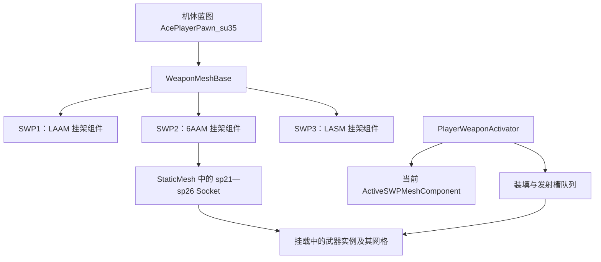

# 双 SP 持续挂载模型：研究与离线原型

## 2026-10-14：独立分支恢复研究

用户已要求恢复可行性研究，先研究 Su-30SM。本分支新增[Su-30SM 报告](su30sm-dual-mount.md)，基于当前 0.1.9，并取得该机自己的挂点资料。Su-30SM 的 6AAM 和 LAGM 挂位接近，不能直接沿用下文 Su-35S 的机腹方案；首个候选改为 6AAM＋QAAM。下文“暂缓”保留为历史阶段决定，本轮尚未实现或安装双模型功能。

**对下文旧推断的修正：** 本轮 Su-30SM 现场已确认三套挂架和三种静态武器模型同时存在；一次 QAAM→6AAM 切换后对象身份保持，只改变显隐。全量初始化仍会重建战斗槽状态，但不能据此说静态网格组件也必然被销毁。应把持久显示组件与持久战斗分组分开研究，详情以上述新报告为准。

## 体验候选 7：MSL 保持挂载

用户报告 SP2→MSL 会无必要地重建 SP1。原因是 Lua 在 MSL 待机时预先装入第一个有弹药的 SP，以处理当前挂载耗尽时原生按键不改变类别的情况。候选 7 删除待机重建，改为监听原生 ToggleSpecial 的实际请求；只有按键后才转到可用 SP。正常 SP2→MSL 保留 SP2 模型，下一次选择 SP1 才替换。此项不是双模型同时挂载，新增行为待用户实玩。

TLS 结束另见[候选 7 说明](../experience-polish.md)，不靠隐藏模型掩盖活动激光。

返回[项目入口](../../AGENTS.md)。武器状态机制见[核心研究](core-findings.md)，当前功能和阶段见[项目状态](../../AGENTS.md#当前状态)。

状态：按用户最新要求，暂不实现，但保留为后续研究目标。理论上可以实现；符合“两个挂载始终存在、实际发射与挂点对应、装填和剩余弹药同步”的完整方案，需要原生发射槽重映射、持续模型生命周期管理以及逐机体布局适配。此次只完成原始资源解析和离线挂点分配原型，没有实现或安装游戏内双模型功能；未启动游戏。后续优先在单机体上确认发射槽与武器实例生命周期，再决定是否扩展到多机体。

## 需求与术语

希望看到两种武器始终搭载在各自挂点，切换只改变当前使用的兵装；导弹/炸弹从对应模型所在位置脱离，吊舱从对应位置发射，弹舱门动作也应对应。

原生 `SWP1/SWP2/SWP3` 指机体三个三选一配置，**不是** DualSP 的逻辑 SP1/SP2。例如当前 Su-35S 的 LASM + 6AAM，对应原生配置 SWP3 + SWP2。

## 实际资源结构

只读解析本机 Steam build 9855922 的 Su-35S 机体蓝图、三套挂架 StaticMesh、Skeleton，以及 LAAM/6AAM/LASM/QAAM 武器蓝图。游戏 PAK、EXE、存档与已安装模组没有修改。

机体蓝图的三套 SWP 组件都挂在 `WeaponMeshBase`，对应 `su35_SWP1_SM`、`su35_SWP2_SM`、`su35_SWP3_SM`。基类蓝图提供 `GetSwpMeshes`。三套网格分别携带 `sp11…sp16`、`sp21…sp26`、`sp31…sp34` 的 Socket；位置与旋转均在资源中给出，不需要凭截图猜坐标。

挂架网格与可发射武器不是同一层。武器蓝图包含导弹网格、移动组件、火焰/灯光及装填参数。`PlayerWeaponActivator` 中存在当前挂架引用、`SpawnedWeapons`、`ActiveWeapons` 等字段；当前普通 SP 管理路径只有一个活动 SP 配置。

当前 DualSP 的 `weapon_bridge.cpp` 在换 SP 时调用完整的 `InitializeWeaponSystem`，随后恢复弹药和冷却。这个调用也重建所选配置的挂架/武器池，所以外观会突然变化；仅保持弹药缓存并不能保留另一套已挂载武器模型。

此前保存的原生发射槽记录中，每槽为 0x60 字节，除了装填时间，还可辨认出局部位置、四元数和缩放，以及不透明引用数据；引用与名称字段的完整语义尚未确认。现有稳定核心只缓存需要恢复的标量及计时，没有保存两套可同时运行的武器实例管理结构。记录中的字段不能全部视为已经确认的写入接口，不能直接复制不透明指针来保持第二套武器。

## 离线实现尝试

原型：[分配脚本](../../src/dual_mount_plan.py)；数据：[结构摘要](../../evidence/weapon-model-layout.json)；结果：[几何原型记录](../../evidence/dual-mount-prototype.json)；既有检查：[检查源码](../../tests/mount_plan_test.py)。

### 直接叠加两套原生挂载

Su-35S 的 LAAM 与 6AAM Socket 虽然名称不同，但六个位置与旋转相同。LAAM 基类的 `MaxLoadedCount` 是 2，6AAM 是 6。分配原型要求完整保留这两个装填数量且挂位不重复，找不到解。降低 6AAM 到四枚能腾出位置，但会改变六联发射体验，原型明确拒绝这种方案。

这说明“把未选中的 SWP 组件也设为可见”不能成为通用解决办法。它最多显示额外挂架，没有为另一种武器建立独立、正确的发射与装填关系。

### 6AAM + LASM 的机腹候选

LASM 原生网格有四个 Socket：`sp31/sp32` 位于翼下内侧，`sp33/sp34` 位于机腹两侧。其 `MaxLoadedCount` 是 2。几何候选让 6AAM 保留六个翼下位置，LASM 使用机腹两个位置，可以在布局层面保留 6 + 2。

但原生 LASM 队列仍包含四个槽，不会因为装饰模型放到了机腹就自动改变实际发射位置。原型提出将原生四槽按下表映射到两个机腹 Socket：

| 原生槽 | 候选实体挂点 |
|---|---|
| sp31 | sp33 |
| sp32 | sp34 |
| sp33 | sp33 |
| sp34 | sp34 |

离线检查验证了四种队列游标下，连续两个装填槽不会映射到同一个机腹位置。**这只证明队列映射候选自洽，不证明网格无碰撞、原生挂载/发射接口可这样改，或游戏会正确执行。**

未完成的部分包括：更改实际槽变换和 Socket、重绑已经生成的弹体、保留并同步未选中武器模型、处理冷却后模型重新出现、协调两套挂架显示、在切换/补给/检查点/卸载时正确清理。仅移动显示模型而不改变实际发射槽，会出现导弹从另一个位置生成的问题，违背需求。

## 可行性与取舍

| 路线 | 判断 |
|---|---|
| 始终显示两套挂架 | 较容易，但不能保证两种实弹都出现，且部分挂位重复；不采用 |
| 添加第二种静态武器模型 | 可做局部展示，但默认没有脱离、装填或正确发射来源；不作为成品 |
| 单机体固定组合，配合真实发射槽改造 | 技术上有候选，工程难度较高，需要额外原生接口验证和游戏测试 |
| 多机体、任意双 SP、吊舱和内置弹舱完整联动 | 难度很高；需要逐机体布局/挂架适配，并处理不同武器与舱门动画 |

因此暂缓当前版本的完整双模型功能，目标与研究证据保留，后续再研究。保留用户已经确认可用的兵装核心，不安装装饰性替代物。模型瞬变仍是当前版本的已知限制。

## 参考与证据边界

- [武器替换作者的高级安装说明](https://www.nexusmods.com/acecombat7skiesunknown/articles/99)：作者明确记载缺少发射挂点会减少齐射数量，以及补齐数量后部分导弹在发射时凭空出现。这与本需求中的“模型与实际发射必须一致”直接相关。
- [机体 Pawn 编辑作者指南](https://www.nexusmods.com/acecombat7skiesunknown/articles/119)：展示机体武器类配置的修改，也明确说明其教程未涵盖带真实模型的副武器；可改武器类不等于已实现正确模型联动。
- [AC7 工具仓库](https://github.com/TTFH/Ace-Combat-7-Mods)：历史工具与资源路径参考；仓库已标记过时，不能当作当前完整实现方案。
- [UAssetAPI AC7 解码源码](https://github.com/atenfyr/UAssetAPI/blob/master/UAssetAPI/AC7Decrypt.cs)：此次对用户自有资源副本进行离线解码的依据。

未下载或发布原始游戏网格。完整资源副本和中间解析 JSON 在资产整理时回收，只保留上述结构摘要与研究结论；研究报告不等于可用的模型模组。
